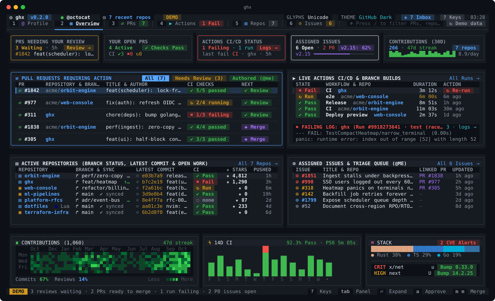
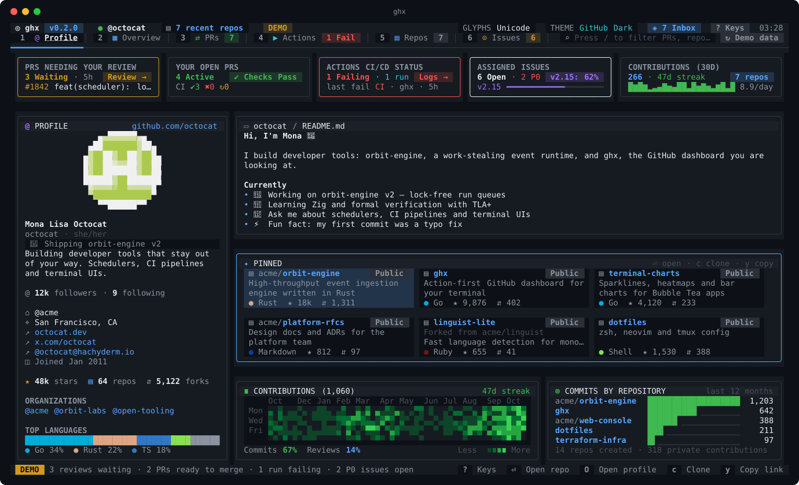
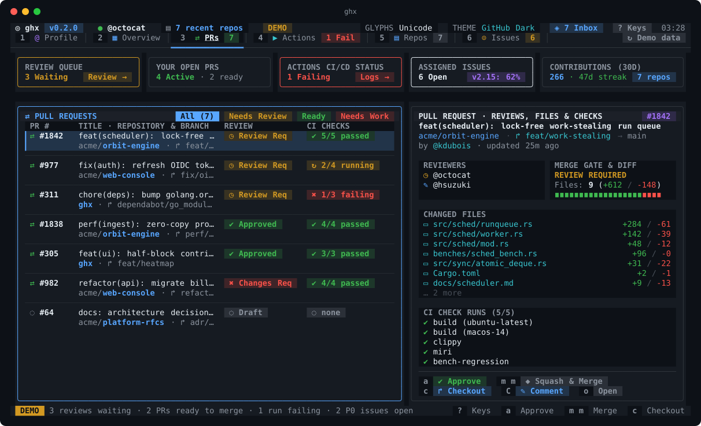
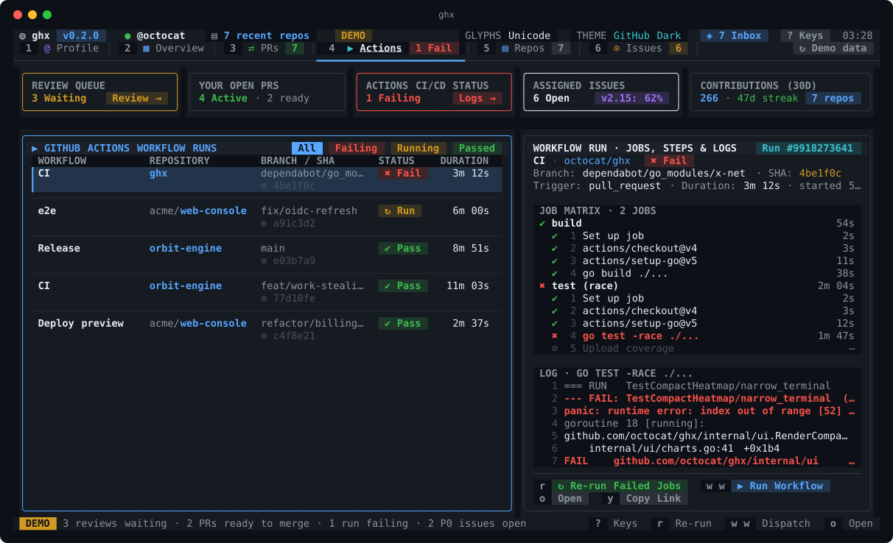
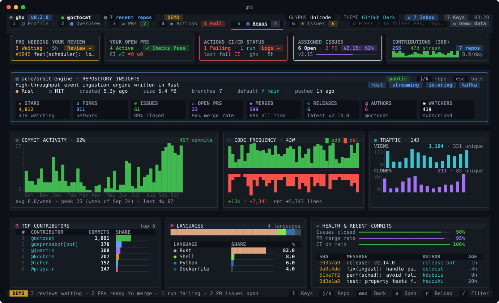
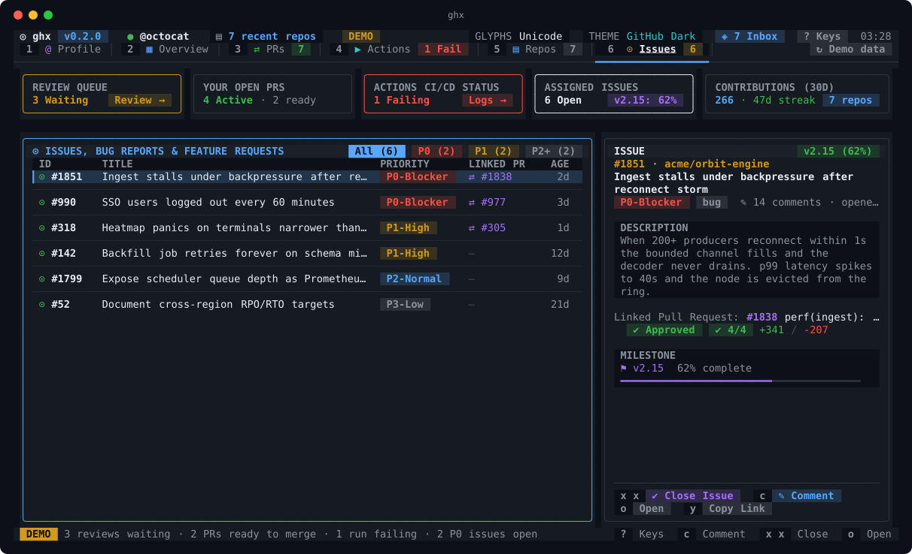
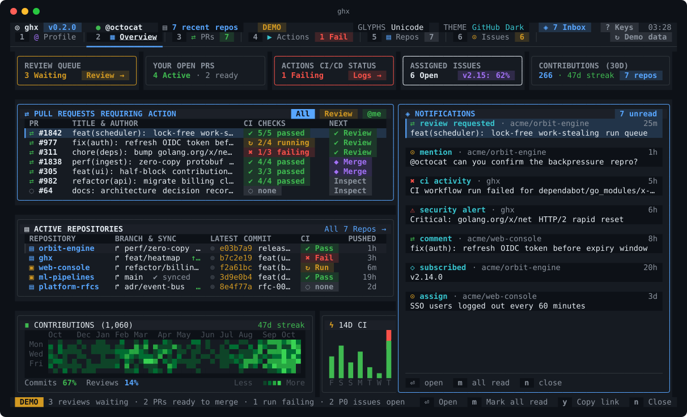
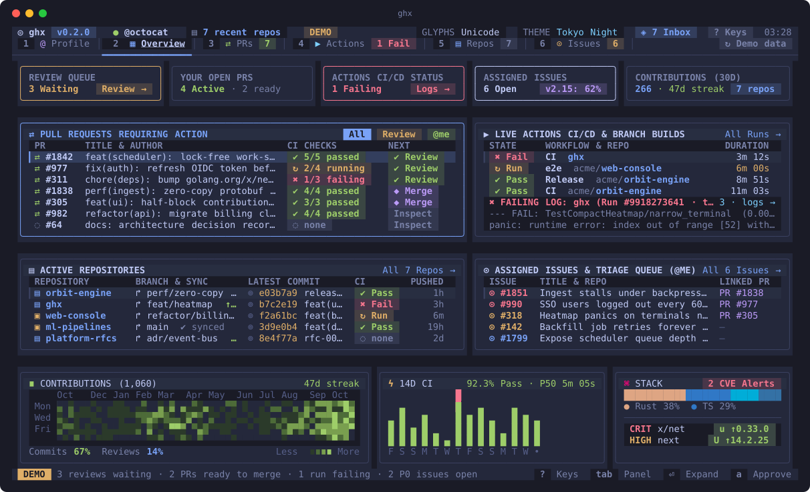
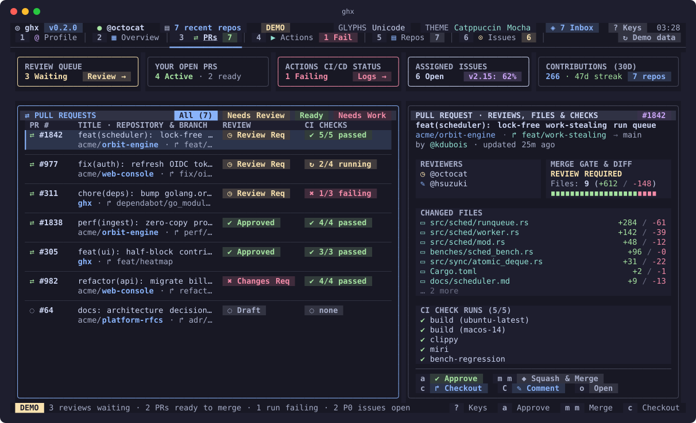
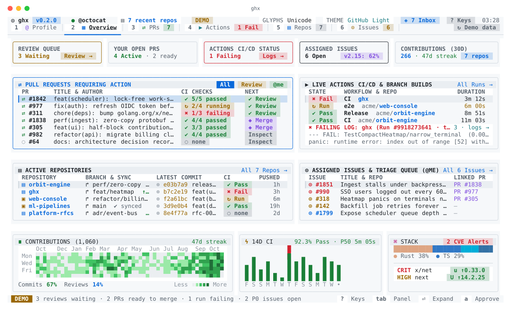

<div align="center">

<pre>
 ██████╗ ██╗  ██╗██╗  ██╗
██╔════╝ ██║  ██║╚██╗██╔╝
██║  ███╗███████║ ╚███╔╝
██║   ██║██╔══██║ ██╔██╗
╚██████╔╝██║  ██║██╔╝ ██╗
 ╚═════╝ ╚═╝  ╚═╝╚═╝  ╚═╝
</pre>

### Your GitHub universe, in your terminal.

Review queue, failing CI, repository insights, issues and notifications on one screen —<br>
and one keystroke from **approve**, **merge**, **re-run**, **comment** or **checkout**.

[](https://github.com/Tukesh1/ghx/actions/workflows/ci.yml)
[](https://github.com/Tukesh1/ghx/releases)
[](https://goreportcard.com/report/github.com/Tukesh1/ghx)
[](LICENSE)



</div>

```sh
curl -fsSL https://raw.githubusercontent.com/Tukesh1/ghx/main/install.sh | sh
ghx --demo     # look around with sample data — no token needed
ghx            # your live dashboard
```

## Why ghx

- **Your GitHub profile, in the terminal.** Avatar (drawn in pixel art), bio, profile README, pinned
  repositories, the contribution graph and where your commits went — just like github.com/you.
- **Everything that needs you, at a glance.** PRs waiting on your review, your PRs that are ready to merge,
  the CI run that just broke (with the failing log line), P0 issues and unread notifications — on one screen.
- **Act without context switching.** Approve, merge, re-run failed jobs, dispatch a workflow, close an issue,
  write a comment or check a PR out locally, right from the list. Destructive actions need a second keypress.
- **Insights you normally click through five pages for.** Commit activity, code frequency, traffic and
  referrers, contributors, languages and health for any repository, rendered as real charts.
- **Fast and safe by design.** One binary, no config. Loads in parallel, paints instantly from cache,
  refreshes in the background, and works offline in demo mode. Your token never leaves your machine
  except to talk to `api.github.com`.

## Install

| Platform | Command |
| --- | --- |
| macOS / Linux | `curl -fsSL https://raw.githubusercontent.com/Tukesh1/ghx/main/install.sh \| sh` |
| Windows (PowerShell) | `irm https://raw.githubusercontent.com/Tukesh1/ghx/main/install.ps1 \| iex` |
| Go 1.22+ | `go install github.com/Tukesh1/ghx@latest` |
| From source | `git clone https://github.com/Tukesh1/ghx && cd ghx && make install` |

The installers download the prebuilt binary for your OS and CPU from the latest
[release](https://github.com/Tukesh1/ghx/releases), verify its SHA-256 checksum and install to
`/usr/local/bin` (or `~/.local/bin`). Pin a version or location with `GHX_VERSION=v0.2.0` and
`GHX_INSTALL_DIR=~/bin`. Uninstall with `rm "$(command -v ghx)"`.

### Sign in

ghx uses the token you already have:

1. `GITHUB_TOKEN` or `GH_TOKEN`, if set, otherwise
2. the [GitHub CLI](https://cli.github.com)'s login (`gh auth login` once, then ghx just works).

A classic token needs the `repo` and `read:org` scopes (add `workflow` to dispatch workflows) — exactly what
`gh auth login` grants.
Without any credentials ghx opens the demo instead of failing.

> **Icons:** ghx draws GitHub's Octicons from a [Nerd Font](https://www.nerdfonts.com). Without one, press
> <kbd>i</kbd> (or run `ghx --ascii`) for plain Unicode glyphs; your choice is remembered. In VS Code / Cursor,
> ghx detects a missing Nerd Font and switches automatically.

## Tour

| | |
| --- | --- |
| **1 · Profile** — your github.com profile: pixel-art avatar, bio, status, followers, organizations and top languages; your profile README; pinned repositories as cards; the contribution graph and commits by repository. <kbd>enter</kbd> opens a pinned repository, <kbd>O</kbd> your profile. |  |
| **2 · Command Center** — KPI cards, PRs requiring action, live CI with the failing log line, active repos with branch sync, assigned issues, 52-week contribution heatmap, 14-day CI pass/fail chart, languages and Dependabot alerts. |  |
| **3 · Pull Requests** — review queue and your PRs with review, CI and merge state. The inspector shows reviewers, what blocks the merge, changed files and failing checks first. |  |
| **4 · Actions** — recent workflow runs across your repositories; the job matrix with per-step status and durations, and the log excerpt of the step that failed. |  |
| **5 · Repositories** — stars, forks, branch sync and CI; press <kbd>enter</kbd> for full-screen **Insights**: commit activity, code frequency, traffic, referrers, contributors, languages and health. |  |
| **6 · Issues** — your assigned issues triaged into P0–P3 from their labels, with linked PRs, description and milestone progress. Comment or close without leaving the terminal. |  |
| **Inbox** — press <kbd>n</kbd> for unread notifications. <kbd>enter</kbd> opens the thread and marks it read. |  |

Five themes: GitHub Dark, Tokyo Night, Catppuccin Mocha, Dracula and GitHub Light. Press <kbd>t</kbd> to cycle;
ghx remembers your pick.

<p align="center">



</p>

## Keys

| Key | Action | Key | Action |
| --- | --- | --- | --- |
| <kbd>1</kbd>–<kbd>6</kbd> | switch view | <kbd>a</kbd> | approve PR |
| <kbd>j</kbd> <kbd>k</kbd> · wheel | move selection | <kbd>m</kbd> <kbd>m</kbd> | merge PR (squash, merge or rebase — whatever the repo allows) |
| <kbd>tab</kbd> · <kbd>h</kbd> <kbd>l</kbd> | focus panel (Command Center) | <kbd>c</kbd> | checkout PR · copy clone command · comment on issue |
| <kbd>enter</kbd> | expand panel · open Insights · open in browser | <kbd>C</kbd> | comment on PR or issue |
| <kbd>/</kbd> | fuzzy filter | <kbd>r</kbd> | re-run failed jobs |
| <kbd>f</kbd> | cycle filter chips | <kbd>w</kbd> <kbd>w</kbd> | run workflow (`workflow_dispatch`) |
| <kbd>esc</kbd> | back · clear filter | <kbd>x</kbd> <kbd>x</kbd> | close issue |
| <kbd>n</kbd> | notifications inbox | <kbd>o</kbd> · <kbd>y</kbd> | open in browser · copy link |
| <kbd>O</kbd> | open your github.com profile | | |
| <kbd>t</kbd> · <kbd>i</kbd> | cycle theme · toggle glyphs | <kbd>R</kbd> | refresh now |
| <kbd>?</kbd> | all shortcuts | <kbd>q</kbd> | quit |

The footer always shows the keys that apply to what is selected. Mouse works too: click tabs, KPI cards, rows
and the header's theme, glyph, inbox and keys controls; click a selected row again to open it.

**Safety:** merge, close and dispatch ask for a second keypress, and any other key cancels. `c` only runs
`gh pr checkout` when your current directory is a clone of that PR's repository; anywhere else it copies the
command instead, so a branch never lands in the wrong repo.

## Options

```text
ghx [--demo] [--org NAME] [--theme NAME] [--ascii] [--refresh 5m]

--demo      explore an offline sample dataset
--org       scope pull requests, issues and repositories to one organization (or user)
--theme     github-dark | tokyo-night | catppuccin-mocha | dracula | github-light
--ascii     plain Unicode glyphs instead of Nerd Font Octicons
--refresh   background refresh interval (default 5m, minimum 30s)
--version   print the version
```

| Environment | |
| --- | --- |
| `GITHUB_TOKEN` / `GH_TOKEN` | token to use instead of the GitHub CLI's |
| `GHX_THEME` | default theme |
| `GHX_ASCII=1` / `GHX_NERD=1` | force Unicode glyphs / Nerd Font Octicons |
| `GHX_CONFIG_DIR` · `GHX_CACHE_DIR` | where settings and the dashboard cache live |

Settings (theme, glyphs) are saved to `ghx/config.json` in your OS config directory. The last live dashboard is
cached with `0600` permissions in your user cache directory (`~/Library/Caches/ghx` on macOS, `~/.cache/ghx`
on Linux), so ghx paints instantly and refreshes in the background.

## How it works

ghx is a single Go binary built on [Bubble Tea](https://github.com/charmbracelet/bubbletea) and
[Lip Gloss](https://github.com/charmbracelet/lipgloss).

- **Loading.** Six small GraphQL queries — you, your profile, your repositories, review requests, your PRs,
  assigned issues — run in parallel, then REST calls add workflow runs, job logs, notifications, Dependabot alerts
  and branch sync. Your avatar is downloaded without your token and drawn with half-block pixels.
  If one section fails (a 502, a SAML-protected org), the rest still render and the header says what is missing.
- **Actions.** Approve, merge, close, comment, re-run, dispatch and mark-as-read call the GitHub REST API with
  your token. Only checkout shells out to `gh`, because it needs your local git setup.
- **Insights** (statistics, traffic, contributors) load on demand the first time you inspect a repository.
- **Resilience.** Reads retry on network errors and 5xx answers; failed refreshes back off (5s → 2m) and keep
  the last good data on screen. 401s and rate limits are explained, not swallowed.

```
main.go               flags, auth, --check / --snapshot
internal/config       themes, saved settings, Nerd Font detection
internal/github       API client, dashboard loading, mutations, analytics, cache, demo dataset
internal/ui           Bubble Tea model, views, tables, charts, modals
tools/screenshot      renders the README screenshots from the demo dataset
```

## Troubleshooting

| Symptom | Fix |
| --- | --- |
| Boxes or blank squares instead of icons | install a [Nerd Font](https://www.nerdfonts.com) and select it in your terminal, or press <kbd>i</kbd> |
| `GitHub rejected the token (401)` | `gh auth refresh`, or export a valid `GITHUB_TOKEN` |
| Header shows **⚠ N partial** | one section failed to load — the footer names it; ghx retries on the next refresh |
| No notifications | fine-grained tokens can't read notifications; use `gh auth login` or a classic token |
| Traffic says "needs push access" | GitHub only shares traffic with people who can push to the repository |
| Install hangs before anything prints | GitHub's CDN (`raw.githubusercontent.com`) is slow or blocked on some networks. Use the mirror: `curl -fsSL https://cdn.jsdelivr.net/gh/Tukesh1/ghx@main/install.sh \| sh`, or `go install github.com/Tukesh1/ghx@latest` |
| Layout looks cramped | ghx needs at least 80×24 and shines at 140×40 or larger |

## Contributing

Issues and pull requests are welcome — see [CONTRIBUTING.md](CONTRIBUTING.md). The short version:

```sh
make demo     # run against the offline dataset
make check    # vet, race tests, and render every view at 80×24, 120×36 and 160×48
```

## License

[MIT](LICENSE)
