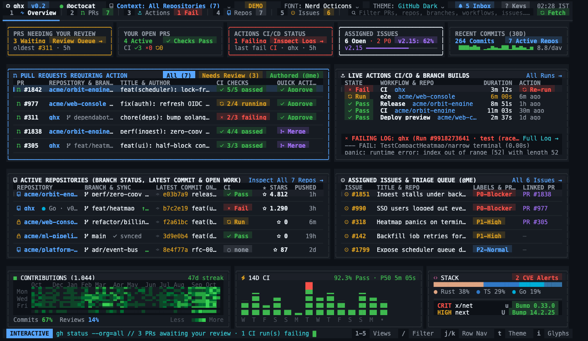
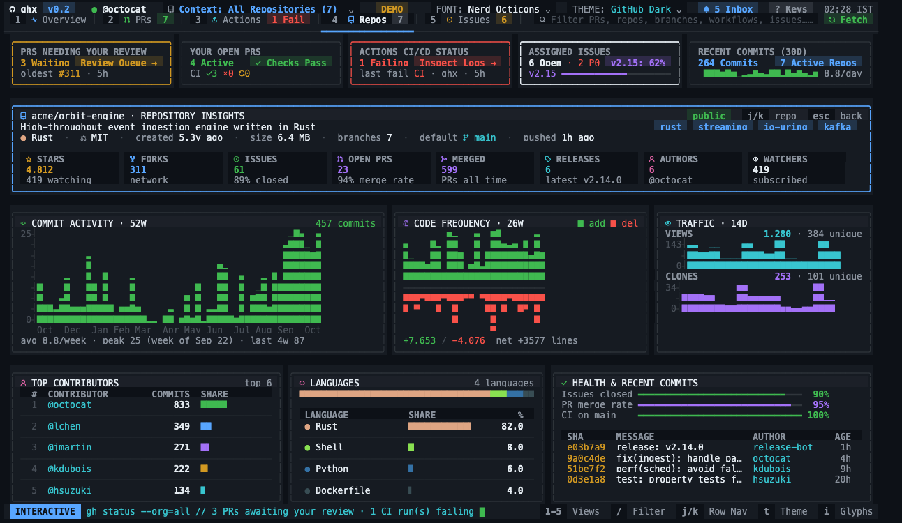
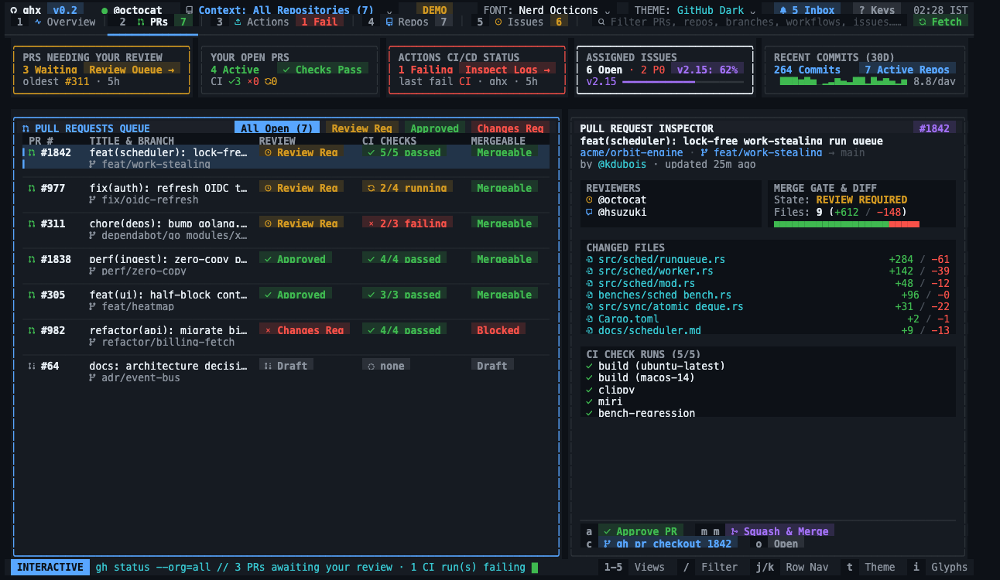
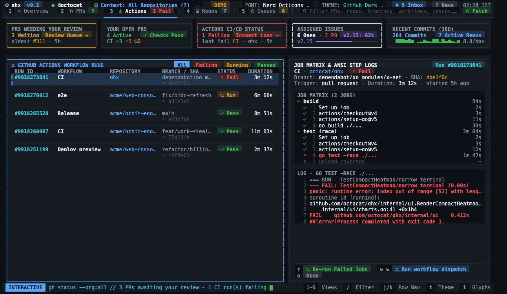
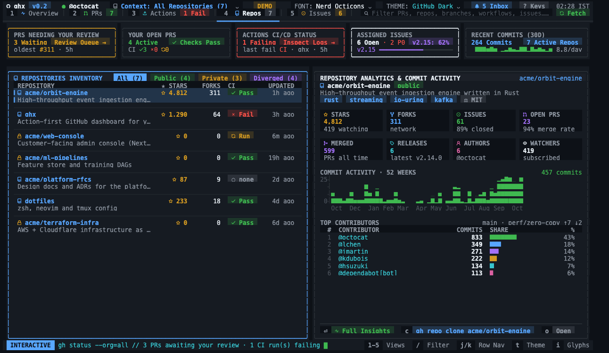

<div align="center">

<pre>
 ██████╗ ██╗  ██╗██╗  ██╗
██╔════╝ ██║  ██║╚██╗██╔╝
██║  ███╗███████║ ╚███╔╝
██║   ██║██╔══██║ ██╔██╗
╚██████╔╝██║  ██║██╔╝ ██╗
 ╚═════╝ ╚═╝  ╚═╝╚═╝  ╚═╝
</pre>

**Your GitHub universe, in your terminal.**

An action-first GitHub dashboard: review queue, failing CI, repository insights and your issues —
one keystroke from approve, merge, re-run or checkout.

[](https://github.com/Tukesh1/ghx/actions/workflows/ci.yml)
[](https://github.com/Tukesh1/ghx/releases)
[](LICENSE)



</div>

## Install

**macOS / Linux**

```sh
curl -fsSL https://raw.githubusercontent.com/Tukesh1/ghx/main/install.sh | sh
```

**Windows (PowerShell)**

```powershell
irm https://raw.githubusercontent.com/Tukesh1/ghx/main/install.ps1 | iex
```

The installer downloads the prebuilt binary for your OS and CPU from the latest
[release](https://github.com/Tukesh1/ghx/releases), verifies its SHA-256 checksum, and puts it in
`/usr/local/bin` (or `~/.local/bin` when that isn't writable). No clone, no Go toolchain.

<details>
<summary>Other ways to install</summary>

```sh
# A specific version, or a custom location
curl -fsSL https://raw.githubusercontent.com/Tukesh1/ghx/main/install.sh | GHX_VERSION=v0.1.0 GHX_INSTALL_DIR=~/bin sh

# With Go 1.22+
go install github.com/Tukesh1/ghx@latest

# From source
git clone https://github.com/Tukesh1/ghx && cd ghx && make install
```

Uninstall with `rm "$(command -v ghx)"`.
</details>

## Quick start

```sh
ghx --demo          # try it instantly with an offline sample dataset
gh auth login       # once, if you haven't used the GitHub CLI yet
ghx                 # your live dashboard
```

ghx reads your token from `GITHUB_TOKEN` / `GH_TOKEN`, or from the [GitHub CLI](https://cli.github.com)
(`gh auth token`). Actions such as approve and merge run through `gh`, so install it for the full experience.
Without any credentials ghx starts in demo mode instead of failing.

> **Icons:** ghx uses GitHub's Octicons from a [Nerd Font](https://www.nerdfonts.com). Install one and
> select it in your terminal. In VS Code / Cursor set `"terminal.integrated.fontFamily": "<Your> Nerd Font Mono"`.
> When ghx detects an editor terminal without a Nerd Font it falls back to Unicode glyphs automatically;
> override with `GHX_NERD=1` or `GHX_ASCII=1`.

## What's inside

| View | What you get |
| --- | --- |
| **1 · Command Center** | KPI cards, PRs requiring action, live CI with the failing log line, active repos with branch sync, assigned issues, a 52-week contribution heatmap, 14-day CI pass/fail chart, language mix and Dependabot CVE bumps |
| **2 · Pull Requests** | Review queue + your PRs with CI, review and merge state; inspector with reviewers, merge gate, changed files and check runs |
| **3 · Actions CI/CD** | Workflow runs; job matrix with per-step status and durations, ANSI-colored step logs |
| **4 · Repositories** | Inventory with stars, forks, sync and CI; analytics with stat tiles, 52-week commit activity and top contributors |
| **⏎ · Repo Insights** | Full-screen analytics: commit activity, code frequency (+/−), 14-day traffic & referrers, contributors, languages, health and recent commits |
| **5 · Issues & Bugs** | P0/P1 triage, labels, linked PRs, description and milestone progress |

<table>
<tr><td></td><td></td></tr>
<tr><td></td><td></td></tr>
</table>

## Keys

| Key | Action | Key | Action |
| --- | --- | --- | --- |
| `1`–`5` | switch view | `a` | approve PR (`gh pr review --approve`) |
| `j` / `k`, wheel | move selection | `m` `m` | squash-merge PR (press twice) |
| `tab` / `h` `l` | focus panel (Command Center) | `c` | checkout PR · copy clone · comment on issue |
| `enter` | inspect · open Repo Insights | `r` | re-run failed jobs · refresh |
| `esc` | back · clear filter | `w` `w` | run `workflow_dispatch` (press twice) |
| `/` | fuzzy filter | `x` `x` | close issue (press twice) |
| `f` | cycle filter chips | `o` | open in browser |
| `t` | cycle theme | `u` / `U` | Dependabot CVE bump |
| `i` | Nerd Font ↔ Unicode glyphs | `n` | notifications inbox (`m` marks all read) |
| `?` | all shortcuts | `q` | quit |

Mouse works too: click tabs, KPI cards and rows; click a selected row again to open it.

## Options

```text
ghx [--demo] [--org NAME] [--theme NAME] [--ascii]

--theme   github-dark | tokyo-night | catppuccin-mocha | dracula   (or GHX_THEME)
--org     scope PRs, issues and repositories to one organization
--ascii   plain Unicode glyphs instead of Nerd Font Octicons       (or GHX_ASCII=1)
--version print the version
```

The last live snapshot is cached in your user cache directory (`~/Library/Caches/ghx` on macOS,
`~/.cache/ghx` on Linux) with `0600` permissions, so ghx paints instantly and refreshes in the
background every 5 minutes.

## How it works

One batched GraphQL query loads your PRs, repositories, issues and contribution calendar; REST calls
fill in workflow runs, job logs, notifications and Dependabot alerts concurrently. Repository insights
(statistics, traffic, contributors) load on demand the first time you inspect a repo. Mutations shell out
to `gh`, so they use exactly the permissions you already granted the GitHub CLI.

```
main.go               flags, auth fallback, --check / --snapshot
internal/config       themes (4 TrueColor palettes), Nerd Font detection
internal/github       auth, GraphQL + REST client, repository analytics, cache, demo dataset
internal/ui           Bubbletea model, views, tables, charts, modals
```

## Contributing

Issues and pull requests are welcome — see [CONTRIBUTING.md](CONTRIBUTING.md). The short version:

```sh
make check    # vet + tests + render every view at 80x24, 120x36 and 160x48
make demo     # run against the offline dataset
```

## License

[MIT](LICENSE)
